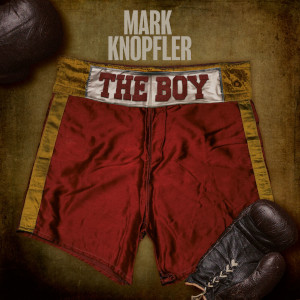

= The Boy
Mark Knopfler
2024
:toc:

From: https://www.azlyrics.com/m/markknopfler.html

== Mr. Solomons Said

[verse]
____ 
One day Mr Solomons said
There was a little black cloud over your head
Anyway you've received a threat
Or so he understands
I'm a country lad but I see it too
How much it's got to you
And now you're slipping down
Into the shadowlands

My life's the fighting game
I keep my cool, I stay the same
We never mind how bad it is
In fact we like all your
Showbiz shenanigans
And Jack wants to help you out
Is what it's all about
With Mr Solomons

We like the flashbulbs, pop, pop, pop
All the razzamatazz
We like the big nights, the West End lights
And all of that jazz

And you can bet
Jack is never going back
To Frying Pan Alley
You can bet Jack is never going back
To Frying Pan Alley

He signed me as a prospect, see
Then something let go in my knee
But I'm no clapped out punchateer
Like some of the other ones
Promoting's all about the gate
Information's worth its weight
I'm the eyes and ears and it's great
With Mr Solomons

Daytimes I'll make the rounds
In every caff and every pub In this part of town
There's a mug or a pug
And always someone blathering
It's gossip calypso all day long
Who's the money going on
Who's been training wrong
Got hurt or struggling

Well I might have a couple with a cornerman
The one with the sponge and bucket
I've maybe got a bottle for a club doorman
Tickets for a waitress in my pocket

She said 'It's me or the ring, Jack' years ago
So he swapped his gloves for Savile Row
Jack's no pushover though
He likes that story told
Behind the pinstripe buttonhole
Behind the yellow rose
Beats a heart of gold

Now he's got me something new
Which is to look out for you
I said, 'I'd be happy to, Mr Solomons'
One day Mr Solomons said
'London, son, we have got some hard pavements'
There's more to the man than the motto read
On the wall above his head
'Winners win, losers make their own arrangements'

You can bet Jack is never going back
To Frying Pan Alley
Yeah, you can bet Jack is never going back
To Frying Pan Alley
You can bet Jack is never going back
To Frying Pan Alley
Yeah, you can bet Jack is never going back
To Frying Pan Alley
____ 

== The Boy

[verse]
____
Sandwich in my pocket
Topcoat buttoned tight
Still thirty miles to pedal
On these empty roads at night
But the moon's a giant lantern
There's no need for a light
I'll be home in good time In the morning

The Boy turned pro so early
Went down London way
I'll pay a visit now and then
Make sure he's okay
We don't do too much talking
We look forward anyway
Sometimes we'll just talk
About the same old

Who knows where the world is going
Nobody does
But all the same
We could never change
We could never change
Because he's all we've got
No more or less
The Boy, God bless
He's just The Boy

There's no sign he'll pack it in
Says why should he stop
He makes more money in that gym
Than in any blacksmith's shop

He seems to like the glamour
The crowds and city lights
He likes the cash, he likes the flash
And fuss around the fights
Will he know when it's all over
Will he still be sharp and bright
Still be working
Still be on a payroll?

Who knows where the world is going
Nobody does
But all the same
We could never change
We could never change
Because he's all we've got
No more or less
And he's The Boy
God bless
He's just The Boy
The Boy, God bless
He's just The Boy
____

== All Comers

[verse]
____
There'll be one or two in every crowd
One or two lads being loud
Having themselves a weekend
Come out the beer tent with their mates
Look over where we stand and wait
Going to want to be showing off to the girlfriend
Over to the booth they'll come and stand
One's going to want to put up his hand
But he's maybe had a drink
Never seen a real ring
He can take on his pals, keep on his shirt
We don't want locals getting hurt
Our people on the show are all the real thing

We were here back then since way back when
In the long hot summers
Here back then and we're back again
And taking on all comers
All comers

You keep your hands up
And your expectations slim
And you never underestimate
The man who's climbing in

Well it's a hard way to earn a pound alright
You'll maybe get three or four fights a night
Maybe more on a weekend
But we want to see them back in here
When we come round again next year
May it never change, just like old friends

We were here back then since way back when
In the long hot summers
Here back then and we're back again
And taking on all comers
All comers
____

== Bad Day For A Knife Thrower

[verse]
____
Rain's like thunder on the canvas
It's been coming down hard all day
You'll get the weather
And the people all staying away
On the old showground
On the edge of town
And the wind buffeting the van
Well, whatever
I still don't have a plan

Tried to call you once or twice
Drawing a blank
That thing we talked about
I need to see it in the bank
Sitting like a dud in the fairground mud
Everything is slower
It's been a bad day
For a knife thrower

It was a pound a round in '64
With all us kids to feed
They stuck together
For whatever it was we'd need
Truth is he was flying
On one engine all the time
Out on the racecourse
He knew a bookie in disorganised crime

When he couldn't pick up a payday
Or anything else
He'd have to come through
With a tenner or two
Have a little bet against himself
Sitting like a dud in the fairground mud
Feel I'm sinking lower
It's been a bad day
For a knife thrower
Sitting like a dud in the fairground mud
Feel I'm sinking lower
It's been a bad day
For a knife thrower
____

////
==

[verse]
____
____
////