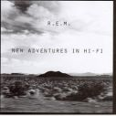

= New Adventures In Hi-Fi
R.E.M.
1996
:toc:

From https://www.azlyrics.com/r/rem.html

== How The West Was Won & Where It Got Us

[verse]
____
blood from a stone, water from wine.
Born under an ill-placed sign.
a stroke of bad luck, wrong place, wrong time.
this flyer is out of line.

The story is a sad one, told many times.
the story of my life in trying times.
just add water, stir in lime.
how the west was won and where it got us.
ahhhh.

the canary got trapped in the uranium mine.
I struck bad luck, now the bird has died.
a marker to mark where my tears run dry
at the crossing of blessed and alkaline.

The story is a sad one, told many times.
the story of my life in trying times.
just add water, stir in lime.
how the west was won and where it got us.
ahhhh.

I didn't wear glasses cause I thought it might rain.
now I can't see anything.
I made a mistake, chalked it up to design.
I cracked through time/space, godless and dry.
I point my nose to the northern star,
and watch the decline from a hazy distance.

The story is a sad one, told many times.
the story of my life in trying times.
just add water, stir in lime.
how the west was won and where it got us.
ahhhh 
____

== Wake Up Bomb

[verse]
____
(I...was...cool)

I look good in a glass pack
I look good and mean
I look good in metallic sick wraparound blackout tease
I scud along the horizon, I drink some sweet tree tea
I get high in my low-ass boot-cut jean
I like being seen
I look good with my drink-eat-no-sleep, take-a-leap longevity
I get high on my attitude, latitude, 1973
I'm in deep

My head's on fire and high esteem
Carry my dead, bored, been there, done that, anything
Oh, the wake-up bomb
Oh, the wake-up bomb
Oh, the wake-up bomb
Oh, the wake-up bomb
My head's on fire and high esteem
Get drunk and sing along to Queen
Practice my T-Rex moves and make the scene
Carry my dead, bored, been there, done that, anything

I had to knock a few buildings over
I make an ugly mess
I had to blow a gasket
Drop transmission
I had to decompress
I had to write the great American novel
I had a neutron bomb
I had to teach the world to sing by the age of 21
I wake up (I wake up)
I wake up (I wake up)
I threw up when I saw what I'd done

Oh, the wake-up bomb
Oh, the wake-up bomb
My head's on fire and high esteem
Get drunk and sing along to Queen
Practice my T-Rex moves and make the scene
Yeah, I'd rather be anywhere doing anything

I've had enough, I've seen enough, I've had it all, I'm giving up
I won the race, I broke the cup, I drank it all, I spit it up
I've had enough, I've seen enough, I've had it all, I'm giving up
I won the race, I broke the cup, I drank it all, I spit it up

Yeah, atomic, Supersonic
What a joke, I'm dumb
See ya, don't wanna be you
Lunch meat, Pond scum

My head's on fire in high esteem
Get drunk and sing along to Queen
Practice my T-Rex moves and make the scene
Yeah, I'd rather be anywhere doing anything
Yeah, I'd rather be anywhere doing anything
Yeah, I'd rather be anywhere doing anything 
____

== New Test Leper

[verse]
____
I can't say that I love Jesus
that would be a hollow claim.
He did make some observations
and I'm quoting them today.
"Judge not lest ye be judged."
what a beautiful refrain.
The studio audience disagrees.
Have his lambs all gone astray?

Call me a leper
Call me a leper
Call me a leper

"You are lost and disillusioned!"
what an awful thing to say.
I know this show doesn't flatter.
It means nothing to me.
I thought I might help them understand
but what an ugly thing to see.
"I am not an animal"
subtitled under the screen.

Call me a leper
Call me a leper
Call me a leper

When I tried to tell my story
They cut me off to take a break.
I sat silent 5 commercials
I had nothing left to say
The talk show host was index-carded
All organized and blank
The other guests were scared and hardened
What a sad parade.

What a sad parade

Call me a leper
Call me a leper
Call me a leper 
____

== Undertow

[verse]
____
I know what I wanted.
I know what I wanted.
I know how I wanted this to be.
You go down to the water.
Drink down of the water.
Walk up off the water, leave it be.

This is not my dream sister.
It is cold in heaven and I'm not sprouting wings.
I'm drowning...me.
I'm drowning...me, yeah.

Brother can you see those birds?
They don't look to heaven.
They don't need religion they can see.
They go down to the water,
Drink down on the water,
Fly up off the water, leave it be.

This is not my time sister,
It is cold in heaven
And no one's coming after me.
I'm drowning (breathing ourselves) me (breathing ourselves).
I'm drowning (breathing ourselves) me (breathing ourselves) yeah.

You know I am tired.
Cold and bony tired.
Nothing's gonna save me, I can see.
I can't say I'm fearful, I can't say I'm not afraid.
But I am not resisting, I can see.
I don't need a heaven, I don't need religion.
I am in the place where I should be.

I am breathing water, I am breathing water.
You know a body's got to breathe.
I'm drowning (breathing ourselves) me (breathing ourselves).
I'm drowning (breathing ourselves) me (breathing ourselves).
I'm drowning (breathing ourselves) me (breathing ourselves). 
____

== E-Bow The Letter

[verse]
____

Look up, what do you see?
all of you and all of me
florescent and starry
some of them, they surprise

the bus ride, I went to write this, 4:00 a.m.
this letter
fields of poppies, little pearls
all the boys and all the girls sweet-toothed
each and every one a little scary
I said your name

I wore it like a badge of teenage film stars
hash bars, cherry mash and tinfoil tiaras
dreaming of Maria Callas
whoever she is
this fame thing, I don't get it
I wrap my hand in plastic to try to look through it
Maybelline eyes and girl-as-boy moves
I can take you far
this star thing, I don't get it

I'll take you over, there
I'll take you over, there
aluminum, tastes like fear
adrenaline, it pulls us near
I'll take you over
it tastes like fear, there
I'll take you over

will you live to 83?
will you ever welcome me?
will you show me something that nobody else has seen?
smoke it, drink
here comes the flood
anything to thin the blood
these corrosives do their magic slowly and sweet
phone, eat it, drink
just another chink
cuts and dents, they catch the light
aluminum, the weakest link

I don't want to disappoint you
I'm not here to anoint you
I would lick your feet
but is that the sickest move?
I wear my own crown and sadness and sorrow
and who'd have thought tomorrow could be so strange?
my loss, and here we go again

I'll take you over, there
I'll take you over, there
aluminum, tastes like fear
adrenaline, it pulls us near
I'll take you over
it tastes like fear, there
I'll take you over

look up, what do you see?
all of you and all of me
florescent and starry
some of them, they surprise

I can't look it in the eyes
seconal, Spanish fly, absinthe, kerosene
cherry-flavored neck and collar
I can smell the sorrow on your breath
the sweat, the victory and sorrow
the smell of fear, I got it

I'll take you over, there
I'll take you over, there
aluminum, tastes like fear
adrenaline, it pulls us near
I'll take you over
it tastes like fear, there
I'll take you over

pulls us near
tastes like fear...

nearer, nearer
over, over, over, over
yeah, look over
I'll take you there, oh, yeah
I'll take you there
oh, over
I'll take you there
over, let me
I'll take you there...
there, there, baby, yeah 
____

== Leave

[verse]
____

Nothing could be bring me closer.
Nothing could be bring me near.
Where is the road I follow
To leave, leave?

It's under, under, under my feet.
The sea spread out there before me.
Where do I go when the land touches sea?
There is my trust in what I believe.

That's what keeps me,
That's what keeps me,
That's what keeps me down,
To leave, believe it,
Leave it all behind.

Shifting the dream
Nothing could bring me further from my old friend time.
Shifting the dream
It's charging the scene
I know where I marked the signs.

I suffer the dreams of a world gone mad
I like it like that and I know it
I know it well, ugly and sweet,
I temper madness with an even extreme.

That's what keeps me
That's what keeps me
That's what keeps me down
I say that I'm a bantam lightweight
I say that I'm a phantom airplane
That never left the ground.

That's what keeps me,
That's what keeps me,
That's what keeps me down,
To leave it, believe it.
Leave it all behind.

Lift me, lift me,
I attain my dream.
I lost myself, I lost the
Heartache calling me.
I lost myself in sorrow
I lost myself in pain.
I lost myself in gravity,
Memory, leave, leave.

That's what keeps me,
That's what keeps me,
That's what keeps me down,
To leave it, believe it,
Leave it all behind.

That's what keeps me,
That's what keeps me,
That's what keeps me down,
To leave it, believe it,
Leave it all behind.

Lift my hands, my eyes are still,
I'll walk into the sea
Shoot myself in a different place
And leave it

I've longed for this to take me,
I've longed for my release
I've waited for the callin'
To leave, leave.

Leave, leave.
Leavin', leavin' 
____

== Departure

[verse]
____
Just arrived Singapore, San Sebastian, Spain, 26-hour trip.
Salt Lake City, come in spring over the salt flats.
A hailstorm brought you back to me.
Salt Lake City, come in spring over the salt flats.
A hailstorm brought you back to me.

Here it comes (I'm carried away)
Here it comes (I'm carried away)
Here it comes, bad.

Departure, godspeed, bless his heart, good lord.
What a fuck-up, what a fighter.
Free-fall, motorcycle, hang-glider,
Hung on the line like a poison spider.
Win a eulogy from William Greider,
car crash, ptomaine, disposable lighter,
a bus plunge, avalanche, RV, vinegar cider.
Free-fall, motorcycle, hang-glider.

Here it comes (I'm carried away)
Here it comes (I'm carried away)
Here it comes, bad.

Go, go, go, go, yeah.

Well, everybody is young forever.
There's so much to tell you, so little time.
I've come a long way since, uh, whatever,
shit, I still see that word and think of you.
There is so much that I can't do, yeah.
You will be young forever.
There is so much that I can't do.
There is so much that I can't do.

Here it comes (I'm carried away)
Here it comes (I'm carried away)
Here it comes, bad. 
____

== Bittersweet Me

[verse]
____
I move across, innocence lost
All flashing pulsar
I move across the earth in my new pattern shirt
I pass satellites

"You're so bitter," your complaint
I can't give you anything
I don't know who you're livin' for
I don't who you are anymore

I'd sooner chew my leg off
Than be trapped in this
How easy you think of all of this as bittersweet me

I couldn't taste it
I'm tired and naked
I don't know what I'm hungry for
I don't know what I want anymore

I move across, candy floss
I move like a tank
I move across the room with a heart full of gloom
I'm stronger than you think

Oh, my peer, your veneer
Is wearing thin and cracking
The surface informs that underneath
The underneath is lacking

I'd sooner chew my leg off
Than be trapped in this
How easy you think of all of this as bittersweet me

I couldn't taste it
I'm tired and naked
I don't know what I'm hungry for
I don't know what I want anymore

You move across, innocence lost
All static and desire
You're blue in the face from navel gaze
You set yourself on fire

You strip down and lay yourself out
I know you can't fake it
But are you tired and naked?
Are you tired and naked?

Yeah, I'd sooner chew my leg off
Than be trapped in this
How easy you think of all of this as bittersweet me

I couldn't taste it
I'm tired and naked
I don't know what I'm hungry for
I don't know what I want anymore

I couldn't taste it
I'm tired and naked
I don't know what I'm hungry for
I don't know what I want anymore

I couldn't taste it
I'm tired and naked
I don't know what I'm hungry for
I don't know what I want anymore
____

== Be Mine

[verse]
____

("A speed zone up here too")

I never thought of this as funny
It speaks another world to me
I want to be your Easter bunny
I want to be your Christmas tree.

I'll strip the world that you must live in
of all its godforsaken greed.
I'll ply the tar out of your feathers.
I'll pluck the thorns out of your feet.
you and me.
you and me.

and if I choose your sanctuary
I want to wash you with my hair.
I want to drink of sacred fountains
and find the riches hidden there.

I'll eat the lotus and peyote.
I want to hear the caged bird sing.
I want the secrets of the Temple.
I want the finger with the ring.
you and me.
you and me.
you will see.

that if you make me your religion
I'll give you all the room you need.
I'll be the drawing of your breath.
I'll be the cup if you should bleed.

I'll be the sky above the Ganges
I'll be the vast and stormy sea.
I'll be the lights that guide you inward.
I'll be the visions you will see.

the visions you will see.

you will see.
you will see.
you and me.
you and me.
you and me.
____

== Binky The Doormat

[verse]
____

This is horror movie stuff.
the muffin is peach, you're 'makin' love'.
you mean this opera involves handcuffs?
I lay defeated.
yeah, sour milk mouth, horseradish sweet.
she's a girl and she's loving me.
but distance is my tendency.
I am defeated.

have you lost your place? (go away, go away)
I wore my doormat face. (go away, go away, go away, go, go, go)
I hung my this or that. (go away, go away, go away, go away)
I laid my welcome mat. (go away, go away)

If I'm your oyster, where's the war?
you leave me gasping, tattered and torn.
I know you can't find a fork.
I am just a little acorn.
well, acorns grow to mighty trees.
you've got sauce, but you don't have knees.
now look who's asking pretty please.
I lay defeated.

have you lost your place? (go away, go away)
I wore my doormat face. (go away, go away, go away, go, go, go)
I hung my this or that. (go away, go away, go away, go away)
I laid my welcome mat. (go away, go away)

Call your bathroom friends around.
I will fake a little frown.
I will be your little clown,
easily defeated.
yeah, shut the door and open wide.
seconal and astroglide.
fuck with me and traumatize.
don't you see i love your hide?
all the beauty that's trapped inside.
can't you see i love your hide?
can't you see i love your hide?
can't you see it?

have you lost your place? (go away, go away)
I wore my doormat face. (go away, go away, go away, go, go, go)
I hung my this or that. (go away, go away, go away, go away)
I laid my welcome mat. (go away, go away, go away, go, go, go)

go away, go away, go away, go away,
go away, go away 
____

== Zither

(Instrumental)

== So Fast, So Numb

[verse]
____
You're moving through rough waters
Motor boy
And swimming in your sleep
How could I be so blind, mis-sighted
Not to see there's something wounded deep

Anyone could scratch your surface now
It's all amphetamine
You're blasting yourself into the present
To blur some past indignity, say that

You say that
You hate it
You want to re-create it

I've been around, I've been your lover
I let it go at Kill Devil Hills
You're coming onto something so fast, so numb
That you can't even feel

You're drinking raw adrenal baby
And do-si-do, saddo
You're eating cartilage, shark-eyes, shark-heart
All present tense
Boy, your blood is running cold

Listen! This is now, this is here
This is me, this is what I wanted
You to see
That was then, that was that
That is gone, that is past
You cast yourself, cast
Passed by, thrown down fast, you say

You say that
You hate it
You want to re-create it

I've played this round, I've played your lover
I've played it out and to the hilt
You're coming onto something so fast, so numb
That you can't even feel

You love it
You hate it
You want to re-create it
Now! This is here, this is me
This is what I wanted you to see
That was then, that was that
That is gone, that is what
I wanted you to feel

You love it
You hate it
I'm spitting out the bitter pill

I've been around, I've been your lover
I let it go at Kill Devil Hills
You're coming onto something so fast, so numb
That you can't even feel

I've played this round, I've played your lover
I've played it out and to the hilt
You're coming onto something so fast, so numb
That you can't even feel

You've played around, you played me lover
I let it go at Kill Devil Hills
You're moving so hard, so fast, so numb
That you can't even feel 
____

== Low Desert

[verse]
____
It happened fast, it's over quick.
A little dust and the engine kicks.
Did you hands drift down off the wheel?
Roll out, hit your windshield
An eyelash or a little bit of sleep?
Time stands still.
Just call it now and you're on your way (hey, a hey hey, hey)

All the ashtrays, cities and the freeway drives
Broken casino and waterslides
Eighteen-wheeler, payback dice.
Gravity flows on the power line.
Jet stream cuts the desert sky.
This is a land could eat a man alive.
Say you'll leave it all behind. (hey, a hey hey, hey)

There's a radio tower that's egging me on
Back to the place where you never belong.
Where people thrive on their own contempt.
Whatever meaning is long gone, spent.
If you had to guess or make a bet,
Would you place yourself inside of it?
The mountains yawn, the clouds let out a sigh.
"Tricked again."
Let go, okay. (hey, hey, hey, a hey hey, a hey, hey hey, hey) 
____

== Electrolite

[verse]
____
Your eyes are burnin' holes through me
I'm gasoline
I'm burnin' clean

20th century, go to sleep
You're plasticine
That is obscene
That is obscene

You are the star tonight
You shine electric outta sight
Your light eclipsed the moon tonight
Electrolite
You're outta sight

If I ever want to fly
Mulholland Drive
I am alive

Hollywood is under me
I'm Martin Sheen
I'm Steve McQueen
I'm Jimmy Dean

You are the star tonight
You shine electric outta sight
Your light eclipsed the moon tonight
Electrolite
You're outta sight

If you ever want to fly
Mulholland Drive
Up in the sky

Stand on a cliff and look down there
Don't be scared
You are alive
You are alive

You are the star tonight
You shine electric outta sight
Your light eclipsed the moon tonight
Electrolite
You're outta sight

20th century, go to sleep
Really deep
We won't blink

Your eyes are burnin' holes through me
I'm not scared
I'm outta here
I'm not scared
I'm outta here 
____

