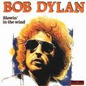
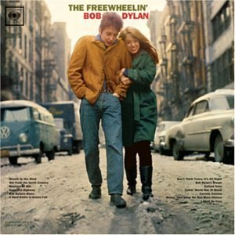
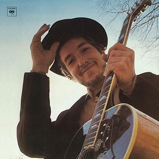
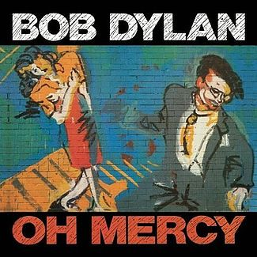
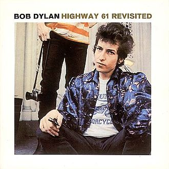
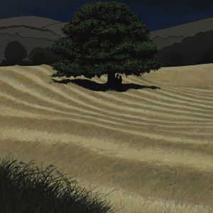
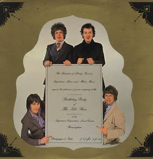

= Радио Аэростат
:toc: left

> link:aerostat.html[<Home>]
> link:toc.html[<Contents>]
> link:lyrics.html[<Lyrics>]

++++

++++

                                                                          
== 44.

=== Боб Дилан, 11 октября 2026
<https://aerostatbg.ru/release/1112>

.Bob Dylan - link:BOB%20DYLAN/Bob%20Dylan%201963%20-%20Blowing%20In%20The%20Wind/lyrics/blowing.html#_one_too_many_mornings[One Too Many Mornings]

.Bob Dylan – Corrina, Corrina

.Bob Dylan – Lay Lady Lay

.Bob Dylan – Man In The Long Black Coat

++++
 
++++

.Bob Dylan - link:BOB%20DYLAN/Bob%20Dylan%201965%20-%20Highway%2061%20Revisited/lyrics/highway.html#_ballad_of_a_thin_man[Ballad Of A Thin Man]

[%hardbreaks]
Bob Dylan – Tomorrow Is A Long Time
Bob Dylan - link:BOB%20DYLAN/Bob%20Dylan%201963%20-%20Blowing%20In%20The%20Wind/lyrics/blowing.html#_like_a_rolling_stone[Like A Rolling Stone]
Bob Dylan – This Wheel's On Fire
Bob Dylan - link:BOB%20DYLAN/Bob%20Dylan%201963%20-%20Blowing%20In%20The%20Wind/lyrics/blowing.html#_positively_4th_street[Positively 4th Street]

++++
 
++++

=== Новые Песни Октября, 4 октября 2026
<https://aerostatbg.ru/release/1111>

[%hardbreaks]
U2 – Silencio
Dave Stewart – The Way It Was Back Then
Jethro Tull – Stigmata
Tom Petty & The Heartbreakers – Parade Of Loons
Falling In Reverse, Corey Taylor & Serj Tankian – Joseph
Shooglenifty – Puirt
Seasick Steve – Above Ground Boogie
Brian Finnegan – If You Are Not Rain
Neil Young (feat. Chrome Hearts) – Earth Girl
Shaggy (feat. Sting) – Til A Mawnin

++++
 
++++

=== Новое Сегодня, 27 сентября 2026
<https://aerostatbg.ru/release/1110>

.Sairie – The Gairdner

[%hardbreaks]
Demob Happy – Power Games
Getdown Services – I Can't Die Like That
Leenalchi – Tiger Is Coming
This Is Lorelei – I Will Eat My Heart In The Morning Light
Curio Curio – Menina Passarinho
Silversun Pickups – Au Revoir Reservoir
Ellur (feat. Cai Alty) – False Start
Cribs – A Point Too Hard To Make

++++
 
++++

=== Ино Спит, 20 сентября 2026
<https://aerostatbg.ru/release/1109>

.Brian Eno – I Dormienti

[%hardbreaks]
John Cale & Brian Eno – The Soul Of Carmen Miranda

++++
 
++++

=== Треугольник, 13 сентября 2026
<https://aerostatbg.ru/release/1108>

[%hardbreaks]
Аквариум – Корнелий Шнапс
Аквариум – Поручик Иванов
Аквариум – Марш
Аквариум – Старик Козлодоев
Аквариум – Поэзия
Аквариум – Два тракториста
Аквариум – Мочалкин блюз
Аквариум – Крюкообразность
Аквариум – Матрос
Аквариум – Миша из города скрипящих статуй
Аквариум – Гиневер
Аквариум – Начальник фарфоровой башни
Аквариум – У императора Нерона
Аквариум – Мой муравей
Аквариум – Сергей Ильич (Песня для Марка Болана)

++++
 
++++

=== То Да Сё № 53, 6 сентября 2026
<https://aerostatbg.ru/release/1107>

.Joe Brown – I'll See You In My Dreams

.Idle Race – (Don't Put Your Boys In The Army) Mrs. Ward

.George Harrison – Cheer Down

[%hardbreaks]
ZZ Top – Gimme All Your Lovin'
Dolly Parton – Coat Of Many Colors
Sinéad O'Connor & Terry Hall – All Kinds Of Everything
Aerovons – World Of You
Ahmad Jamal Trio – For All We Know
Lightning Seeds – Change
Maadal – Vande Mataram
Monkees – When Love Comes Knockin' (At Your Door)

++++
 
++++

=== Новые Песни Сентября, 30 августа 2026
<https://aerostatbg.ru/release/1106>

.King Ayisoba – Property

[%hardbreaks]
Mountain Goats – Shallow Grave
Tubs – Stoop To Me
Peter Gabriel – One By One
Eels – Cap In Hand
David Sylvian & Robert Fripp – The First Day
Echo & The Bunnymen – Brussels Is Haunted
Richard Thompson – Cocaine Walking, Booze Talking

++++
 
++++

---

> link:aerostat.html[<Home>]
> link:toc.html[<Contents>]
> link:lyrics.html[<Lyrics>]